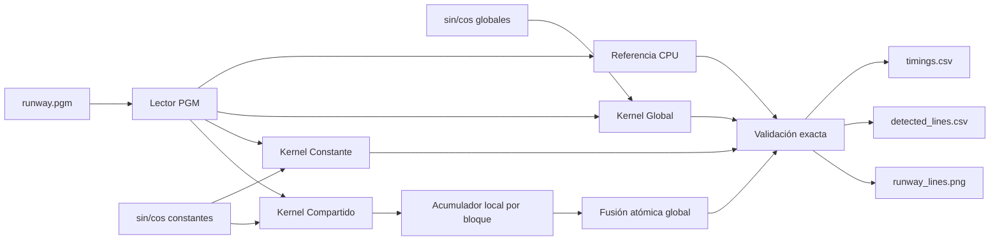

<h1 align="center">Transformada Lineal de Hough con CUDA</h1>

<h3 align="center">Comparación experimental de memoria Global, Constante y Compartida</h3>

<p align="center">
  <a href="https://developer.nvidia.com/cuda-toolkit"></a>
  <a href="https://isocpp.org/"></a>
  <a href="https://www.nvidia.com/"></a>
  <a href="#validación-y-corrección"></a>
  <a href="LICENSE"></a>
</p>

<p align="center">Implementación académica de la Transformada Lineal de Hough para estudiar cómo la jerarquía de memoria de CUDA afecta un algoritmo paralelo de visión por computadora.</p>

<p align="center">
  <a href="#descripción">Descripción</a> ·
  <a href="#arquitectura">Arquitectura</a> ·
  <a href="#inicio-rápido">Inicio rápido</a> ·
  <a href="#ejecución-en-google-colab">Google Colab</a> ·
  <a href="#resultados-oficiales">Resultados</a> ·
  <a href="#pruebas-y-sanitización">Pruebas</a>
</p>

<p align="center">
  
  <br>
  <sub>Salida oficial: máximos de la Transformada de Hough dibujados en rojo sobre la imagen de entrada.</sub>
</p>

---

## Descripción

El proyecto procesa una imagen binaria o en escala de grises y construye un espacio de Hough discretizado en:

- **90 bins angulares**, de 0 a 178 grados con incrementos de 2 grados;
- **100 bins radiales** para el intervalo `[-rMax, rMax]`;
- **9,000 contadores** en cada acumulador.

Cada píxel activo vota por todas las líneas posibles que podrían atravesarlo. Los máximos del acumulador representan las líneas más relevantes de la imagen.

Se implementan y comparan tres variantes:

| Variante | Tablas seno/coseno | Acumulador durante la votación | Propósito |
|---|---|---|---|
| **Global** | Memoria global | Memoria global | Línea base de rendimiento |
| **Constante** | Memoria constante | Memoria global | Evaluar el broadcast y la caché constante |
| **Compartida** | Memoria constante | Memoria compartida por bloque, seguida de fusión global | Reducir la contención de atómicos globales |

El programa también:

- calcula una referencia secuencial en CPU;
- exige igualdad exacta entre los 9,000 bins de CPU y GPU;
- mide únicamente el kernel mediante CUDA Events;
- ejecuta calentamientos antes de las mediciones oficiales;
- genera un PNG con las líneas detectadas;
- guarda tiempos y líneas en archivos CSV;
- administra recursos CUDA mediante RAII y ejecuta `cudaDeviceReset`;
- incluye pruebas de imágenes PGM, un caso sintético y evidencia de Compute Sanitizer.

> [!NOTE]
> La Transformada de Hough es un algoritmo determinista. No existe una etapa de entrenamiento ni un modelo aprendido.

## Arquitectura



### Transformación de coordenadas

Cada hilo procesa un píxel lineal `global_id` y lo transforma a un plano cartesiano cuyo origen está en el centro de la imagen:

```cpp
const int x_coordinate = global_id % width - width / 2;
const int y_coordinate = height / 2 - global_id / width;
```

El módulo obtiene la columna y la división entera obtiene la fila. La coordenada `y` se invierte porque las filas de una imagen aumentan hacia abajo, mientras que el eje cartesiano aumenta hacia arriba.

### Memoria compartida y sincronización

Cada bloque reserva `90 * 100 = 9,000` enteros, equivalentes a **36,000 bytes** de memoria compartida. Los hilos:

1. inicializan cooperativamente el acumulador local;
2. esperan en la primera barrera;
3. registran votos con `atomicAdd`;
4. esperan en la segunda barrera;
5. fusionan el acumulador local con el global.

Los hilos que quedan fuera de la imagen no votan, pero siguen alcanzando ambas barreras para evitar comportamiento indefinido.

---

## Requisitos

### Requisitos de hardware

- GPU NVIDIA compatible con CUDA.
- Al menos 36,000 bytes de memoria compartida por bloque.

### Requisitos de software

- CUDA Toolkit con `nvcc`.
- Compilador C++ host compatible con el Toolkit.
- C++17.
- GNU Make o CMake 3.24+; ambos son opcionales si se usa el comando directo de `nvcc`.
- Compute Sanitizer únicamente para las pruebas avanzadas de memoria.

El entorno oficial utilizado para validar el proyecto fue:

| Componente | Configuración |
|---|---|
| GPU | NVIDIA GeForce RTX 4050 Laptop GPU, 6 GB |
| Compute Capability | 8.9 |
| CUDA Toolkit | 13.4 |
| `nvcc` | 13.4.59 |
| Compilador host | MSVC 19.44 / Visual Studio Build Tools 2022 |
| Sistema de medición | 2 calentamientos + 10 corridas por variante |

---

## Inicio rápido

### Linux o entorno CUDA compatible

```bash
git clone https://github.com/DanielBarillasM/Proyecto-3_CPYD_Grupo-1_Sec-40.git
cd Proyecto-3_CPYD_Grupo-1_Sec-40
make
make run
```

Al terminar deben existir:

```text
results/timings.csv
results/detected_lines.csv
results/runway_lines.png
```

La consola debe imprimir tres veces:

```text
Validacion CPU-GPU: OK
```

### Compilación directa con `nvcc`

```bash
mkdir -p build results
nvcc -O3 -std=c++17 -lineinfo --fmad=false -I. \
  src/hough.cu common/image_io.cpp \
  -o build/hough
```

`--fmad=false` mantiene comparables las operaciones de punto flotante de CPU y GPU al discretizar el radio `r`. Se aplica por igual a los tres kernels.

Ejecución completa:

```bash
./build/hough \
  --input data/runway.pgm \
  --mode all \
  --warmup 2 \
  --runs 10 \
  --sigma 2.4 \
  --max-lines 12 \
  --nms-radius 4 \
  --nms-theta 3 \
  --pixel-threshold 0 \
  --output results/runway_lines.png \
  --csv results/timings.csv \
  --lines-csv results/detected_lines.csv
```

### Windows 10/11

1. Instala Visual Studio Build Tools 2022 con la carga de trabajo de C++.
2. Instala un CUDA Toolkit compatible con el controlador y MSVC.
3. Abre **Developer Command Prompt for VS 2022**.
4. Clona el repositorio y entra a su carpeta:

```bat
git clone https://github.com/DanielBarillasM/Proyecto-3_CPYD_Grupo-1_Sec-40.git
cd Proyecto-3_CPYD_Grupo-1_Sec-40
mkdir build
```

5. Compila:

```bat
nvcc -O3 -std=c++17 -lineinfo --fmad=false -I. src\hough.cu common\image_io.cpp -o build\hough.exe
```

6. Ejecuta el protocolo oficial desde PowerShell:

```powershell
powershell.exe -NoProfile -ExecutionPolicy Bypass `
  -File .\scripts\run_benchmarks.ps1 `
  -Executable ".\build\hough.exe" `
  -Runs 10 `
  -Warmup 2
```

Si `nvcc` no se reconoce, verifica la instalación:

```bat
where nvcc
nvcc --version
```

Si `cl.exe` no se reconoce, la terminal no fue inicializada como Developer Command Prompt o faltan las herramientas de C++.

### CMake

```bash
cmake -S . -B build
cmake --build build --config Release
```

Según el generador, el ejecutable quedará en `build/hough`, `build/hough.exe` o `build/Release/hough.exe`.

---

## Ejecución en Google Colab

Google Colab permite compilar y ejecutar CUDA sin instalar el Toolkit en la computadora personal. El hardware asignado y los límites de uso cambian según disponibilidad, por lo que los tiempos de Colab deben reportarse separados de la corrida oficial.

> [!IMPORTANT]
> Colab usa una máquina virtual temporal. Si la sesión se desconecta, el contenido de `/content` puede desaparecer. Descarga los resultados antes de cerrar la sesión.

### Paso 1: crear el notebook y activar GPU

1. Abre [Google Colab](https://colab.research.google.com/).
2. Crea un notebook nuevo.
3. Ve a **Entorno de ejecución → Cambiar tipo de entorno de ejecución**.
4. Selecciona **GPU** como acelerador de hardware y guarda.

Google no garantiza un modelo específico de GPU ni disponibilidad ilimitada. Consulta la [FAQ oficial de Colab](https://research.google.com/colaboratory/faq.html?hl=es) y las [versiones de runtime disponibles](https://research.google.com/colaboratory/runtime-version-faq.html).

### Paso 2: verificar GPU y compilador CUDA

Ejecuta una celda con:

```python
!nvidia-smi
!nvcc --version
```

También puedes comprobar las rutas:

```python
!which nvcc
!ls -l /usr/local/cuda/bin/nvcc 2>/dev/null || true
```

Si `nvidia-smi` falla, el notebook no tiene GPU activa. Regresa al paso 1. Si la GPU funciona pero `nvcc` no está en `PATH`, ejecuta:

```python
import os
os.environ["PATH"] = "/usr/local/cuda/bin:" + os.environ["PATH"]

!nvcc --version
```

Si `/usr/local/cuda/bin/nvcc` tampoco existe, cambia al runtime actual de Colab o reinicia la sesión. No se recomienda instalar un Toolkit completo con `apt` sin comprobar antes la compatibilidad con el controlador de la VM.

### Paso 3: clonar el proyecto

```python
%cd /content
!git clone https://github.com/DanielBarillasM/Proyecto-3_CPYD_Grupo-1_Sec-40.git
%cd /content/Proyecto-3_CPYD_Grupo-1_Sec-40
!git log -1 --oneline
```

Si ya clonaste el repositorio durante la misma sesión:

```python
%cd /content/Proyecto-3_CPYD_Grupo-1_Sec-40
!git pull --ff-only origin main
```

### Paso 4: compilar

Opción recomendada con Make:

```python
!make clean
!make
```

Opción directa, útil para diagnosticar errores. Coloca `%%bash` en la primera línea de la celda:

```bash
%%bash
mkdir -p build results
nvcc -O3 -std=c++17 -lineinfo --fmad=false -I. \
  src/hough.cu common/image_io.cpp \
  -o build/hough
```

Si compilaste con Make, el ejecutable será `./hough`. Si usaste el comando directo, será `./build/hough`.

### Paso 5: ejecutar las tres variantes

Con el ejecutable generado por Make:

```bash
%%bash
./hough \
  --input data/runway.pgm \
  --mode all \
  --warmup 2 \
  --runs 10 \
  --sigma 2.4 \
  --max-lines 12 \
  --nms-radius 4 \
  --nms-theta 3 \
  --pixel-threshold 0 \
  --output results/runway_lines.png \
  --csv results/timings.csv \
  --lines-csv results/detected_lines.csv
```

También puedes usar el script Linux incluido:

```python
!bash scripts/run_benchmarks.sh
```

La salida correcta debe incluir:

```text
Votos de referencia: 12456540
Validacion CPU-GPU: OK
Validacion CPU-GPU: OK
Validacion CPU-GPU: OK
```

Los tiempos serán distintos a los de la RTX 4050. Los votos, las dimensiones y la validación exacta deben mantenerse.

### Paso 6: visualizar la salida

```python
from IPython.display import Image, display

display(Image(filename="results/runway_lines.png"))
```

Para revisar las líneas seleccionadas:

```python
import pandas as pd

display(pd.read_csv("results/detected_lines.csv"))
```

### Paso 7: resumir los tiempos

```python
import pandas as pd

timings = pd.read_csv("results/timings.csv")

summary = timings.groupby("mode")["kernel_ms"].agg(
    N="count",
    media_ms="mean",
    mediana_ms="median",
    desviacion_ms=lambda values: values.std(ddof=0),
    minimo_ms="min",
    maximo_ms="max",
)

display(summary)
```

Para registrar la GPU asignada:

```python
!nvidia-smi > results/gpu_info_colab.txt
!cat results/gpu_info_colab.txt
```

### Paso 8: descargar los resultados

```python
from pathlib import Path
from zipfile import ZIP_DEFLATED, ZipFile
from google.colab import files

result_files = [
    Path("results/timings.csv"),
    Path("results/detected_lines.csv"),
    Path("results/runway_lines.png"),
    Path("results/gpu_info_colab.txt"),
]

archive = Path("resultados_colab.zip")
with ZipFile(archive, "w", ZIP_DEFLATED) as output:
    for path in result_files:
        if path.exists():
            output.write(path, arcname=path.name)

files.download(str(archive))
```

### Paso 9: Compute Sanitizer en Colab, si está disponible

Comprueba primero si la herramienta está instalada:

```python
!command -v compute-sanitizer || true
```

Si existe:

```bash
%%bash
compute-sanitizer --tool memcheck ./hough \
  --input data/runway.pgm \
  --mode all \
  --runs 1 \
  --warmup 0 \
  --output results/colab_sanitized.png \
  --csv results/colab_sanitized.csv \
  --lines-csv results/colab_sanitized_lines.csv
```

La instrumentación de Compute Sanitizer hace que los tiempos sean artificialmente altos; esos valores no son benchmarks.

### Problemas frecuentes en Colab

| Problema | Causa probable | Solución |
|---|---|---|
| `nvidia-smi` falla | Runtime sin GPU | Seleccionar GPU y reconectar |
| `nvcc: command not found` | CUDA no está en `PATH` o el runtime cambió | Agregar `/usr/local/cuda/bin` al `PATH`; si no existe, reiniciar con un runtime actual |
| El repositorio ya existe | La celda de clonación se ejecutó dos veces | Entrar a la carpeta y usar `git pull --ff-only` |
| El notebook perdió archivos | La VM temporal fue reciclada | Clonar nuevamente y restaurar/descargar resultados |
| Los tiempos no coinciden con el informe | Colab asignó otra GPU | Registrar `nvidia-smi` y reportar la corrida por separado |
| Validación CPU-GPU incorrecta | Compilación distinta o sin configuración conservadora | Recompilar con `--fmad=false` y verificar que se usa el código actual |

---

## Opciones de línea de comandos

| Opción | Descripción | Valor predeterminado |
|---|---|---|
| `--input`, `-i` | Imagen PGM de entrada | `data/runway.pgm` |
| `--output`, `-o` | PNG con las líneas dibujadas | `results/runway_lines.png` |
| `--csv` | CSV de tiempos por corrida | `results/timings.csv` |
| `--lines-csv` | CSV con `r`, `theta` y votos | `results/detected_lines.csv` |
| `--mode`, `-m` | `global`, `constant`, `shared` o `all` | `all` |
| `--runs` | Número de corridas medidas | `10` |
| `--warmup` | Corridas de calentamiento | `2` |
| `--sigma` | Multiplicador del umbral estadístico | `2.0` |
| `--max-lines` | Máximo de líneas dibujadas | `20` |
| `--nms-radius` | Vecindad NMS en bins radiales | `2` |
| `--nms-theta` | Vecindad NMS en bins angulares | `2` |
| `--pixel-threshold` | Ignorar píxeles con intensidad menor o igual | `0` |
| `--help`, `-h` | Mostrar ayuda | — |

La corrida oficial sobrescribe algunos valores predeterminados y usa `sigma=2.4`, `max-lines=12`, `nms-radius=4` y `nms-theta=3`.

## Archivos generados

| Archivo | Contenido |
|---|---|
| `results/timings.csv` | Diez observaciones por cada variante |
| `results/summary.md` | Media, mediana, desviación, mínimo y máximo |
| `results/detected_lines.csv` | Radio, ángulo y votos de las líneas dibujadas |
| `results/runway_lines.png` | Visualización final |
| `results/run_metadata.txt` | Parámetros y versión del Toolkit de la corrida oficial |
| `results/gpu_info.txt` | Información de la GPU oficial |
| `results/validation.log` | Validación CPU-GPU de los tres modos |
| `results/memcheck.log` | Evidencia de accesos de memoria válidos |
| `results/racecheck.log` | Evidencia de ausencia de carreras |
| `results/synthetic_validation.log` | Prueba de bloque incompleto con imagen 7 x 5 |

---

## Metodología de medición

- Las transferencias host-device, `cudaMemset`, la referencia CPU y la escritura del PNG quedan fuera del intervalo medido.
- Cada medición comienza con `cudaEventRecord(start)`, ejecuta un kernel y termina con `cudaEventRecord(stop)`.
- El evento final se sincroniza antes de calcular el tiempo con `cudaEventElapsedTime`.
- Se realizan dos calentamientos y diez mediciones oficiales por variante.
- Todas las variantes usan la misma imagen, discretización, geometría y configuración del compilador.
- No se acepta un tiempo si el acumulador GPU no coincide exactamente con CPU.

## Validación y corrección

Para `data/runway.pgm` se esperan los siguientes invariantes:

| Invariante | Valor esperado |
|---|---:|
| Resolución | `800 x 600` |
| Píxeles | `480,000` |
| Bins angulares | `90` |
| Bins radiales | `100` |
| Tamaño del acumulador | `9,000` |
| Votos totales con `pixel > 0` | `12,456,540` |
| Validaciones CPU-GPU | `3 x OK` |

La visualización usa el umbral:

```text
media del acumulador + sigma * desviación estándar
```

La supresión no máxima considera la circularidad de `theta` y la equivalencia:

```text
(r, theta) = (-r, theta + 180 grados)
```

## Resultados oficiales

Resultados obtenidos en la RTX 4050 Laptop con diez mediciones por variante:

| Variante | Media (ms) | Mediana (ms) | Desv. estándar | Speedup frente a Global |
|---|---:|---:|---:|---:|
| Global | 1.082563 | 1.084368 | 0.003477 | 1.000x |
| Constante | 1.074896 | 1.074704 | 0.003398 | 1.007x |
| Compartida | 0.798310 | 0.798720 | 0.000502 | **1.356x** |

<div align="center">
  
</div>

### Interpretación

- **Constante** mejora aproximadamente 0.71%. Las tablas trigonométricas son pequeñas y la memoria global ya puede beneficiarse de caché, por lo que el impacto total es modesto.
- **Compartida** reduce el tiempo medio aproximadamente 26.26%. La reducción de atómicos globales compensa la inicialización del acumulador local, las barreras y la fusión final.
- El resultado corresponde a una GPU y una entrada concretas; otras arquitecturas, frecuencias o condiciones térmicas pueden cambiar los tiempos.

## Pruebas y sanitización

### Prueba del lector PGM y escritor PNG

```bash
make test-image-io
```

Esta prueba cubre:

- lectura de la imagen oficial P5;
- lectura P2 con comentarios;
- escalado cuando `max_value` es distinto de 255;
- escritura PNG;
- rechazo de una ruta inexistente.

### Prueba GPU de bloque incompleto

La entrada sintética tiene `7 x 5 = 35` píxeles, deliberadamente no múltiplo de 256:

```bash
cmake -S . -B build -DHOUGH_ENABLE_GPU_TESTS=ON
cmake --build build --config Release
ctest --test-dir build -C Release --output-on-failure
```

### Compute Sanitizer

```bash
make sanitize
```

Resultados oficiales:

```text
ERROR SUMMARY: 0 errors
RACECHECK SUMMARY: 0 hazards displayed (0 errors, 0 warnings)
```

---

## Estructura del repositorio

```text
.
├── common/
│   ├── image_io.cpp            # Lector PGM y escritor PNG
│   └── image_io.h
├── data/
│   └── runway.pgm              # Imagen oficial de entrada
├── docs/
│   ├── INFORME_BORRADOR.md
│   └── figures/                # Diagramas y gráfica de tiempos
├── results/                    # Evidencia, CSV, logs y PNG
├── scripts/
│   ├── run_benchmarks.ps1      # Automatización para Windows
│   ├── run_benchmarks.sh       # Automatización para Linux/Colab
│   └── summarize_timings.ps1
├── src/
│   └── hough.cu                # CPU, kernels, medición y visualización
├── tests/
│   ├── data/synthetic_7x5.pgm
│   ├── test_image_io.cpp
│   └── timings_fixture.csv
├── BITACORA.md
├── CMakeLists.txt
├── Makefile
└── README.md
```

## Solución de problemas

### `nvcc` no encuentra un compilador host

- En Windows, usa Developer Command Prompt y verifica `where cl`.
- En Linux, instala un compilador host compatible con la versión del Toolkit.
- Consulta la tabla de compatibilidad del CUDA Toolkit instalado.

### El kernel compartido requiere demasiada memoria

El programa verifica `sharedMemPerBlock` antes de ejecutar. La variante compartida necesita 36,000 bytes por bloque; una GPU con un límite inferior no puede ejecutar esta configuración.

### Los acumuladores CPU y GPU no coinciden

1. confirma que la compilación incluya `--fmad=false`;
2. no cambies la discretización solo en CPU o solo en GPU;
3. usa el mismo `pixel-threshold` en las tres variantes;
4. vuelve a ejecutar con `--runs 1 --warmup 0` para diagnosticar rápidamente.

### La imagen contiene demasiadas líneas

Aumenta `--sigma`, `--nms-radius` o `--nms-theta`, o reduce `--max-lines`. Cualquier cambio debe documentarse porque afecta únicamente la selección visual, no el acumulador medido.

---

## Documentación académica

- [`BITACORA.md`](BITACORA.md): protocolo, mediciones y comprobaciones.
- [`docs/INFORME_BORRADOR.md`](docs/INFORME_BORRADOR.md): contenido técnico del informe.
- [`results/README.md`](results/README.md): inventario de evidencias.
- [`docs/figures/memoria_constante.svg`](docs/figures/memoria_constante.svg): diagrama de memoria constante.
- [`docs/figures/memoria_compartida.svg`](docs/figures/memoria_compartida.svg): diagrama de memoria compartida.

## Autores

- Pablo Daniel Barillas Moreno
- Milton Polanco

Proyecto académico para el curso **Computación Paralela y Distribuida**, Universidad del Valle de Guatemala.

## Referencias

- R. O. Duda y P. E. Hart, “Use of the Hough Transformation to Detect Lines and Curves in Pictures”, *Communications of the ACM*, 1972.
- [NVIDIA CUDA Programming Guide](https://docs.nvidia.com/cuda/cuda-programming-guide/)
- [NVIDIA CUDA Runtime API - Event Management](https://docs.nvidia.com/cuda/cuda-runtime-api/group__CUDART__EVENT.html)
- [Google Colab FAQ](https://research.google.com/colaboratory/faq.html?hl=es)
- [Google Colab Runtime Versions](https://research.google.com/colaboratory/runtime-version-faq.html)

## Licencia

Este proyecto se distribuye bajo la [licencia MIT](LICENSE).
