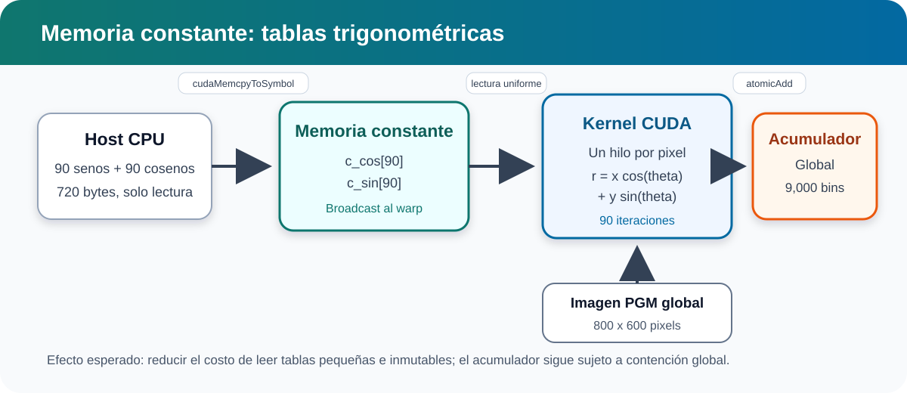
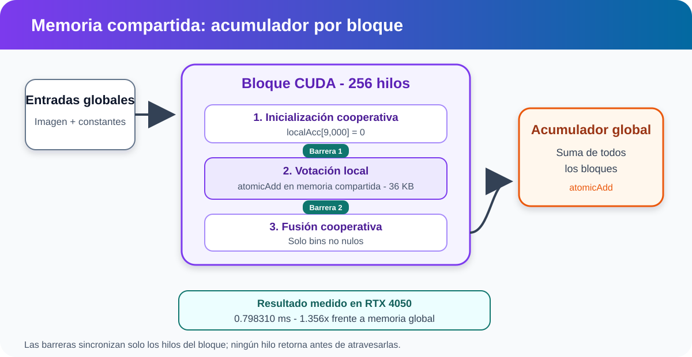
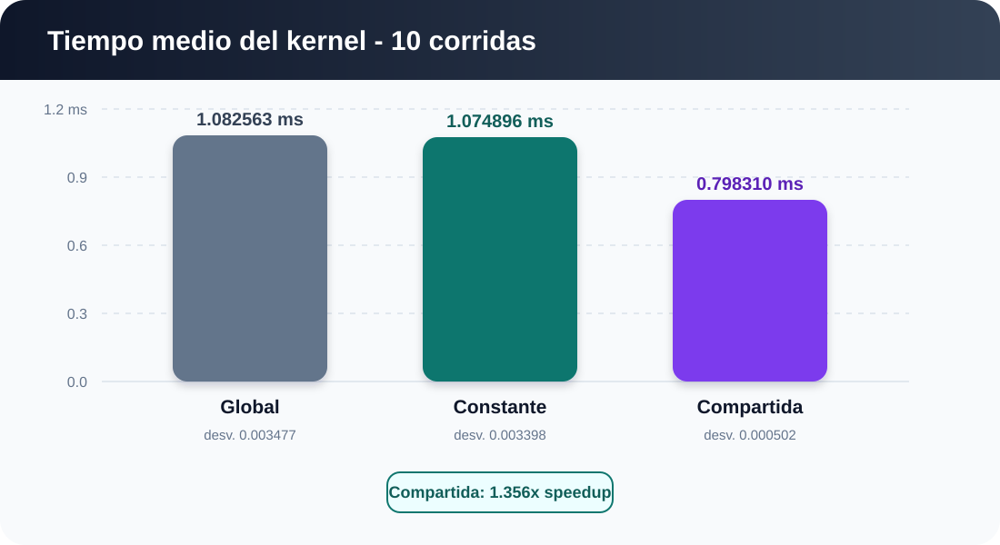
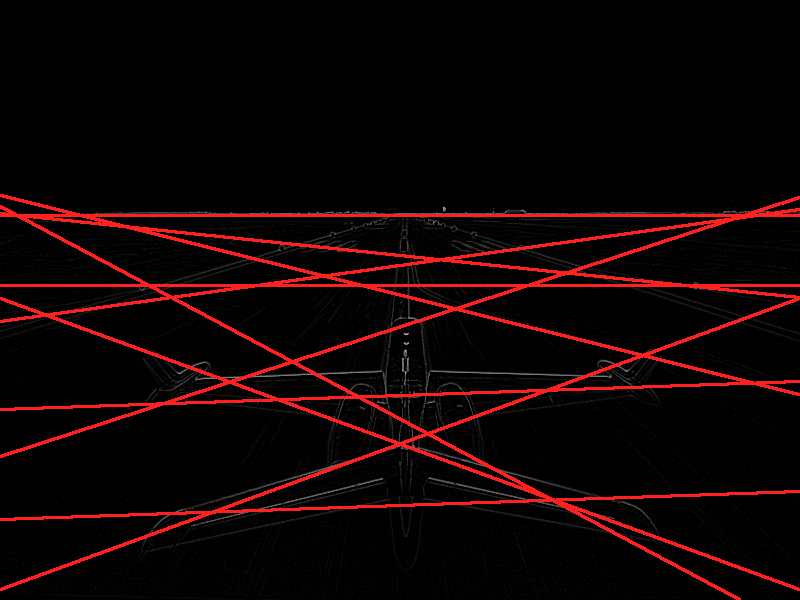

# Universidad del Valle de Guatemala

## Computación Paralela y Distribuida

### Proyecto 3: Transformada Lineal de Hough con CUDA

**Grupo:** 1<br>
**Sección:** 40<br>
**Integrantes:** Pablo Daniel Barillas Moreno y Milton Polanco<br>
**Docente:** Sebastián Galindo<br>
**Fecha:** 25 de octubre de 2026

---

## Índice

1. Introducción
2. Fundamento de la Transformada de Hough
3. Diseño de la implementación
4. Memoria global
5. Memoria constante
6. Memoria compartida
7. Metodología experimental
8. Resultados
9. Visualización de líneas
10. Conclusiones y recomendaciones
11. Referencias
12. Apéndice

## 1. Introducción

Las GPU permiten ejecutar miles de hilos concurrentes, pero el rendimiento de una implementación no depende únicamente de la cantidad de paralelismo. La ubicación de los datos, el patrón de acceso a memoria, la sincronización y la contención de operaciones atómicas pueden cambiar considerablemente el tiempo de ejecución. Este proyecto estudia estos efectos mediante la versión lineal de la Transformada de Hough, un algoritmo de visión por computadora que detecta rectas a partir de una imagen de bordes.

Se implementaron tres versiones CUDA. La primera almacena las tablas trigonométricas y el acumulador en memoria global. La segunda traslada las tablas de seno y coseno a memoria constante. La tercera agrega un acumulador en memoria compartida para cada bloque y posteriormente fusiona sus resultados con el acumulador global. Las tres versiones usan la misma entrada, discretización y configuración de ejecución para permitir una comparación controlada.

## 2. Fundamento de la Transformada de Hough

Una recta puede representarse en forma normal mediante:

\[
r = x\cos(\theta) + y\sin(\theta)
\]

Cada píxel activo `(x, y)` vota por las rectas que podrían contenerlo. El programa discretiza `theta` entre 0 y 178 grados, en incrementos de 2 grados, para obtener 90 bins angulares. El intervalo radial `[-rMax, rMax]` se divide en 100 bins. El resultado es un acumulador de `100 x 90 = 9,000` enteros. Los bins con más votos representan las rectas más respaldadas por la imagen.

La entrada usa coordenadas de imagen, cuyo origen está en la esquina superior izquierda. Para aplicar la ecuación se traslada el origen al centro:

```cpp
x = global_id % width - width / 2;
y = height / 2 - global_id / width;
```

El módulo obtiene la columna y la división entera obtiene la fila. La expresión vertical invierte el eje porque las filas crecen hacia abajo, mientras que el eje cartesiano `y` crece hacia arriba.

## 3. Diseño de la implementación

Se asigna un hilo CUDA por píxel. Un hilo cuyo píxel sea cero termina su trabajo sin votar. Para cada píxel activo se recorren los 90 ángulos, se calcula `r`, se obtiene el bin radial y se incrementa el acumulador correspondiente.

La referencia CPU usa las mismas tablas `float` de seno y coseno y la misma discretización que GPU. Después de cada conjunto de mediciones se copian los 9,000 bins al host y se exige igualdad exacta. Si aparece una diferencia, el programa informa el primer bin incorrecto y no acepta los tiempos.

## 4. Memoria global

La versión base almacena la imagen, las tablas trigonométricas y el acumulador en memoria global. Cada hilo lee un píxel y reutiliza las mismas 90 entradas de seno y coseno. El acumulador también es compartido por toda la cuadrícula, por lo que varios hilos pueden intentar incrementar el mismo bin simultáneamente. Se usa `atomicAdd` para evitar la pérdida de votos por condiciones de carrera.

Esta versión es conceptualmente simple, pero puede generar una gran cantidad de operaciones atómicas sobre memoria global.

## 5. Memoria constante

Las tablas contienen 90 valores `float` cada una, 720 bytes en total, y no cambian durante el kernel. Se declararon símbolos globales de dispositivo:

```cpp
__constant__ float c_cos[90];
__constant__ float c_sin[90];
```

El host las inicializa con `cudaMemcpyToSymbol`. En una iteración angular, todos los hilos de un warp solicitan la misma posición de cada tabla, por lo que la caché constante puede distribuir el valor mediante broadcast. Esta versión mantiene la imagen y el acumulador en memoria global.

El uso de memoria constante no garantiza una mejora grande. Las tablas son pequeñas y podrían permanecer en otras cachés; además, el costo dominante puede ser la contención del acumulador global. La interpretación final debe basarse en las mediciones obtenidas.

### Diagrama conceptual de memoria constante



## 6. Memoria compartida

Cada bloque reserva un acumulador local de 9,000 enteros, equivalente a 36,000 bytes. Los hilos cooperan para inicializarlo en cero usando un bucle con paso `blockDim.x`. Una primera barrera garantiza que la inicialización termine antes de votar.

Los votos se acumulan con operaciones atómicas en memoria compartida. Una segunda barrera garantiza que todos los hilos terminen de votar. Finalmente, los hilos recorren cooperativamente el acumulador local y suman sus valores no nulos al acumulador global.

Los hilos sobrantes del último bloque no pueden retornar antes de las barreras. Únicamente omiten la votación y continúan participando en ambas sincronizaciones.

La estrategia disminuye la cantidad de atómicos globales, pero introduce inicialización, dos barreras, atómicos compartidos y una fusión por bloque. Los 36 KB por bloque también pueden limitar la ocupación. Por lo tanto, esta variante puede ser más rápida o más lenta según la GPU y la distribución de votos.

### Diagrama conceptual de memoria compartida



## 7. Metodología experimental

Las tres variantes usan bloques de 256 hilos y la misma imagen PGM de `800 x 600`. Se realizan dos ejecuciones de calentamiento que no se registran y diez ejecuciones medidas por variante. Antes de cada kernel se limpia el acumulador, pero el `cudaMemset` queda fuera del intervalo medido.

El tiempo se obtiene con dos CUDA Events registrados en el stream predeterminado. El evento final se sincroniza antes de llamar `cudaEventElapsedTime`. Las transferencias, la referencia CPU y la generación del PNG no forman parte de la medición.

Para cada variante se reportan media, mediana, desviación estándar, mínimo y máximo. También se conserva cada observación individual en un CSV.

**Equipo de prueba:** NVIDIA GeForce RTX 4050 Laptop GPU, 6 GB, capacidad de cómputo 8.9, controlador 621.01.<br>
**Versión del Toolkit:** CUDA 13.4, `nvcc` 13.4.59.<br>
**Compilador host:** MSVC 19.44, Visual Studio Build Tools 2022 17.14.42.<br>
**Comando:** consultar `BITACORA.md`.

## 8. Resultados

Se recopilaron diez observaciones por variante después de dos calentamientos. Los acumuladores de las tres variantes coincidieron exactamente con la referencia CPU. El archivo `results/timings.csv` contiene las treinta mediciones individuales.

| Variante | Media (ms) | Mediana (ms) | Desv. estándar | Mínimo | Máximo | Speedup frente a Global |
|---|---:|---:|---:|---:|---:|---:|
| Global | 1.087590 | 1.088512 | 0.004856 | 1.078272 | 1.093632 | 1.000x |
| Constante | 1.078272 | 1.078784 | 0.003720 | 1.072128 | 1.083392 | 1.009x |
| Compartida | 0.800154 | 0.799744 | 0.000502 | 0.799744 | 0.800768 | 1.359x |



La memoria Constante redujo el tiempo medio en 0.86% frente a Global. La mejora es pequeña porque las tablas suman únicamente 720 bytes y el acceso global también puede beneficiarse de caché; además, el costo dominante incluye las actualizaciones atómicas del acumulador. El patrón uniforme de lectura por warp favorece el broadcast constante, pero su impacto total queda limitado por el resto del kernel.

La variante Compartida redujo el tiempo medio en 26.43% y obtuvo un speedup de 1.359x. En esta entrada, disminuir la cantidad de operaciones atómicas sobre memoria global compensó la inicialización de 36 KB por bloque, las dos barreras y la fusión final. También presentó la menor dispersión de las tres variantes. Este resultado corresponde a la RTX 4050 evaluada y no debe generalizarse sin repetir el experimento en otras arquitecturas y entradas.

`compute-sanitizer` reportó cero errores de memoria para los tres kernels. `racecheck` reportó cero peligros, errores o advertencias para el kernel compartido.

## 9. Visualización de líneas

Se calcula el umbral:

\[
T = \mu + 2\sigma
\]

donde `mu` y `sigma` son la media y desviación estándar de los 9,000 bins. Para evitar dibujar varias representaciones vecinas de una misma recta, se aplica supresión de máximos locales con radio 2 en ambas dimensiones del acumulador. Se dibujan hasta 20 líneas en rojo sobre una copia RGB de la imagen y se guarda un PNG sin depender de OpenCV.

La ejecución produjo 11 máximos locales por encima del umbral `3541.58`. La imagen `results/runway_lines.png` se abrió e inspeccionó correctamente. Las líneas más fuertes incluyen el horizonte y varios bordes diagonales y horizontales de la pista y la aeronave. La discretización y el hecho de usar cualquier intensidad mayor que cero también conservan algunas líneas largas que atraviesan regiones secundarias de la imagen.



## 10. Conclusiones y recomendaciones

La versión con memoria Compartida fue la más rápida, con una media de 0.800154 ms y una desviación estándar de 0.000502 ms. El acumulador por bloque disminuyó suficientemente la contención global para compensar su inicialización, sincronización y fusión. No obstante, sus 36 KB por bloque pueden reducir la ocupación, por lo que conviene consultar las propiedades y ocupación de cada GPU antes de generalizar el resultado.

La memoria Constante produjo una mejora medible pero modesta: 0.86% en el tiempo medio. El broadcast de seno y coseno resulta adecuado para el patrón de lectura uniforme, aunque las tablas ya son pequeñas y el acumulador continúa dominado por operaciones atómicas.

La corrección requirió `atomicAdd` tanto para votos concurrentes como para la fusión entre bloques. Las dos barreras del kernel compartido se colocaron después de inicializar y después de votar. Los hilos sobrantes no retornan antes de estas barreras, lo cual evita bloqueos y comportamiento indefinido. La validación exacta CPU-GPU y los resultados de Compute Sanitizer respaldan esta implementación.

Se recomienda conservar el mismo protocolo experimental, realizar calentamientos, reportar la dispersión y repetir más sesiones si se necesita caracterizar diferencias pequeñas como la observada en memoria Constante. Para mejorar la visualización podría evaluarse un umbral previo de intensidad o una supresión no máxima adaptada a la equivalencia entre `(r, theta)` y `(-r, theta + 180 grados)`.

## 11. Referencias

1. R. O. Duda y P. E. Hart, “Use of the Hough Transformation to Detect Lines and Curves in Pictures”, *Communications of the ACM*, vol. 15, núm. 1, pp. 11-15, 1972. https://doi.org/10.1145/361237.361242
2. NVIDIA Corporation, *CUDA Programming Guide*, sección de espacios de memoria y sincronización. https://docs.nvidia.com/cuda/cuda-programming-guide/
3. NVIDIA Corporation, *CUDA Runtime API*, Event Management. https://docs.nvidia.com/cuda/cuda-runtime-api/group__CUDART__EVENT.html

## 12. Apéndice

### Archivos principales

- `src/hough.cu`: referencia CPU, tres kernels, medición, validación y dibujo de líneas.
- `common/image_io.cpp`: lectura PGM y escritura PNG autocontenida.
- `results/timings.csv`: observaciones experimentales.
- `BITACORA.md`: entorno, protocolo y lista de comprobación.

### Criterios de aceptación

- Los tres acumuladores GPU coinciden exactamente con CPU.
- Cada variante tiene diez mediciones.
- `compute-sanitizer` no reporta accesos inválidos.
- La imagen resultante se abre correctamente y muestra líneas detectadas.
- Se libera toda la memoria CPU/GPU, se destruyen eventos y se ejecuta `cudaDeviceReset`.
